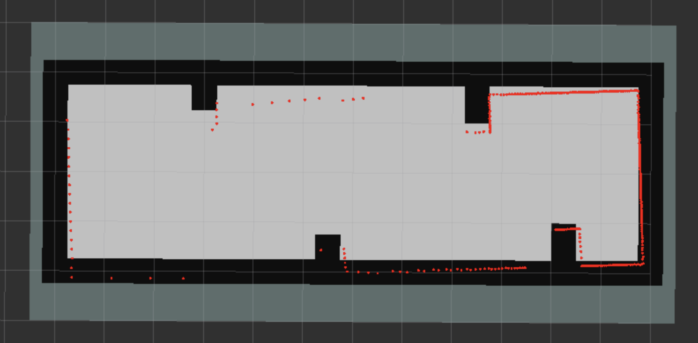

# ПР08: локализация AMCL и цепочка map → odom

## 1. Входные данные

Карта и профиль взяты из недельного комплекта без изменений:

- `map.yaml` — разрешение 0,25 м/ячейку, начало `(-2,5; -3,0; 0)`, размер 52×24;
- `map.pgm` — та же collision-геометрия, что в `mcity-minimal.sdf`;
- `amcl.yaml` — `base_frame_id: base_link`, `odom_frame_id: odom`, `global_frame_id: map`,
  `scan_topic: /vehicle/scan`, начальная поза `(0, 0, 0)`.

SHA-256 скопированных в evidence файлов карты:

| Файл | SHA-256 |
|---|---|
| `map.yaml` | `79d1003f551943d946a047295f100b1980c00415009b52e60cb9a9eaedf66cc0` |
| `map.pgm` | `f190d3ecdbeebe8e9ac476d02dfcc47d51014638b38ba7a1d8a3c604039549de` |

### Почему записана исправленная запись

Исходная `fixtures/pr07-sensors` формально содержит все пять топиков и длится 44,577 с,
но запись начинается на `t=93,162` — через полторы минуты после запуска симуляции. К этому
моменту робот уже доехал до восточной стены и стоял в ней: одометрия продолжала расти
из-за проскальзывания колёс (`x` от 13,94 до 20,62), а все 446 сканов были одинаковыми,
с расстоянием 0,25 м по направлению движения. Локализовать такой робот из начальной позы
`(0, 0, 0)` нельзя: AMCL не получает новой информации о перемещении и остаётся в уверенной,
но неверной позе.

Поэтому той же командой ПР07, в том же мире и с теми же владельцами преобразований была
записана `fixtures/pr07-sensors-fixed`. Робот в ней стартует из `(0, 0, 0)` и едет прямо
со скоростью 0,15 м/с; запись начинается на `t=0,121` и заканчивается на `t=58,199`,
одометрия проходит от 0 до 8,52 м. Старая запись оставлена для evidence ПР07, новая
используется как исправленный вход ПР08. Подробности и состав топиков — в `recording.md`.

## 2. Запуск

```bash
ros2 launch localization_case localization.launch.py \
  params_file:=$PWD/src/localization_case/config/amcl.yaml \
  map:=$PWD/.course-kit/v1/fixtures/pr08/map.yaml

ros2 run localization_case localization_metrics.py --ros-args \
  -p output_path:=$PWD/evidence/pr08/localization.json \
  -p map_yaml:=$PWD/.course-kit/v1/fixtures/pr08/map.yaml \
  -p map_pgm:=$PWD/.course-kit/v1/fixtures/pr08/map.pgm \
  -p recording_path:=fixtures/pr07-sensors-fixed

ros2 bag play fixtures/pr07-sensors-fixed
```

`localization.launch.py` запускает ровно три ноды: `map_server`, `amcl` и
`lifecycle_manager_localization`. Менеджер переводит `map_server` и `amcl` из
`unconfigured` в `active`; в логе есть строка `Managed nodes are active`,
а `ros2 lifecycle get` для обеих нод возвращает `active [3]`.

## 3. Владельцы преобразований

| Преобразование | Владелец | Топик | Подтверждение |
|---|---|---|---|
| `map → odom` | `amcl` (`tf_broadcast: true`) | `/tf`, dynamic | `tf2_echo map odom` показывает translation `[0.242, 0.229]` и yaw `-4.092°` на `t=38.4`; в `/tf` записи этого ребра нет |
| `odom → base_link` | адаптер одометрии ПР07, записанный в bag | `/tf`, dynamic | в `/tf` записи ровно одно ребро `('odom', 'base_link')`, 2903 сообщения |
| `base_link → lidar_link` | `robot_state_publisher` ПР06 | `/tf_static`, static | в `/tf_static` записи `base_link -> lidar_link xyz=(0.000, 0.000, 0.200)` |

Во время replay не запускались вторые владельцы: нет Gazebo, моста, `robot_state_publisher`
и адаптера одометрии — все три преобразования приходят из записи и от AMCL.
`map → odom` публикует только AMCL.

## 4. Дефект base_frame_id: chassis

В копии профиля `config/amcl-defect.yaml` заменена ровно одна строка:

```yaml
base_frame_id: chassis
```

Остальные параметры, карта, запись и начальная поза не менялись.

```bash
ros2 launch localization_case localization.launch.py \
  params_file:=$PWD/src/localization_case/config/amcl-defect.yaml \
  map:=$PWD/.course-kit/v1/fixtures/pr08/map.yaml

ros2 bag play fixtures/pr07-sensors-fixed
```

На каждом скане AMCL пишет:

```text
[amcl]: Couldn't transform from lidar_link to chassis, even though the message notifier is in use:
("chassis" passed to lookupTransform argument target_frame does not exist. )
```

Всего за дефектный опыт сохранено 119 таких сообщений. `map_server` при этом активен и
читает карту 52×24 с шагом 0,25 м, то есть карта и lifecycle manager исправны.

Проверка `map → odom`:

```text
$ timeout 6 ros2 run tf2_ros tf2_echo map odom --ros-args -p use_sim_time:=true
Waiting for transform map -> odom: Invalid frame ID "map" passed to canTransform argument
target_frame - frame does not exist
```

`map` не существует, потому что AMCL не смог вычислить позу и не опубликовал `map → odom`.
`ros2 topic echo /amcl_pose --once` за 6 секунд не получил ни одного сообщения.
Полный лог и проверки — в `defect-before.txt`.

Порядок остановки дефектного опыта: сначала остановлен launch локализации, пока player
ещё публиковал `/clock` (прогресс player — 24,27 из 58,08 с), затем остановлен player.
Это важно, потому что ожидание отсутствующего transform может зависнуть, если время
симуляции уже остановлено.

## 5. Исправление

В `config/amcl.yaml` возвращён `base_frame_id: base_link`, карта, запись, начальная поза
и окно измерения не менялись. Перед опытом заново запущены локализация, player и измеритель,
поэтому буфер tf2 не содержит преобразований из дефектного запуска.

Результат той же проверки:

```text
$ ros2 lifecycle get /map_server
active [3]
$ ros2 lifecycle get /amcl
active [3]

$ ros2 run tf2_ros tf2_echo map odom --ros-args -p use_sim_time:=true
At time 38.400000000
- Translation: [0.242, 0.229, 0.000]
- Rotation: in RPY (radian) [0.000, 0.000, -0.071]
```

Цепочка `map → odom → base_link → lidar_link` связна: `tf2_echo map base_link` на `t=44.558`
даёт `[6.794, -0.176, 0.000]`, а в `/tf_static` записи лежит статическое смещение
`base_link → lidar_link` с `xyz=(0.000, 0.000, 0.200)`.

## 6. Метрики

Измеритель запускается до player, поэтому первый записанный `/clock` принимается за `t0`.
В этом опыте `t0 = 0,121 с`, окно — `[10,121; 30,121)`, длительность 20 с.

- На каждом шаге 0,1 с симуляции выполняется один `lookup_transform('map', 'odom',
  rclpy.time.Time())`; всего 200 запросов, все 200 успешны, доступность 1,0.
- `/amcl_pose` фильтруется по `header.stamp`: в окно попало 50 сообщений (AMCL публикует
  позу не на каждом скане, а после обновления фильтра).
- Для каждого сообщения считается `covariance[0] + covariance[7]`, затем медиана.
  Получилось `0,026252 м²`, что меньше порога `0,25 м²`.

Итог записан в `localization.json` и проверен валидатором:

```text
PR08 localization.json: схема, метрики и SHA-256 карты корректны
```

Полный вывод — в `schema-check.txt`.

### Метки времени

По записи `fixtures/pr07-sensors-fixed`:

| Топик | Частота | Первая метка | Последняя метка |
|---|---|---|---|
| `/clock` | ~1000 Гц | 0,121 | 58,199 |
| `/tf`, `/vehicle/odom` | 50 Гц | 0,158 | 58,198 |
| `/vehicle/scan` | 10 Гц | 0,200 | 58,100 |

Скан появляется через 0,042 с после первой одометрии и через 0,079 с после первого `/clock`.
Окно измерения целиком помещается в запись: `10,121 + 20 = 30,121 < 58,199`.
Подробности — в `stamps.txt`.

## 7. Наложение скана на карту

Скриншот RViz с конфигом `pr08.rviz`: `Fixed Frame: map`, `Map` с топиком `/map`
(`Transient Local`), `LaserScan` с топиком `/vehicle/scan` (`Best Effort`).



Красные точки скана ложатся на стены коридора и на асимметричные выступы. Остаточный
сдвиг в пределах долей ячейки объясняется упрощённой моделью ПР06: в URDF лидар стоит
в `(0, 0, 0.20)`, а в Gazebo-модели — в `(0.28, 0, 0.38)`. AMCL оценивает позу в той
системе координат, которую ему даёт tf-дерево, поэтому ковариация ниже — это уверенность
фильтра, а не абсолютная ошибка относительно Gazebo.

## 8. Что именно доказывает дефект

Опыты отличаются только значением `base_frame_id`. Карта, запись, начальная поза, окно,
частота запросов и владельцы преобразований одинаковы. При `chassis` tf2 не может найти
кадр, AMCL пропускает каждый скан и не публикует `map → odom`; при `base_link` те же
входные данные дают 200 из 200 успешных запросов и медиану 0,026252 м². Значит, отсутствие
`map → odom` вызвано именем кадра, а не картой, не переустановкой Nav2 и не отсутствием
данных лидара.
